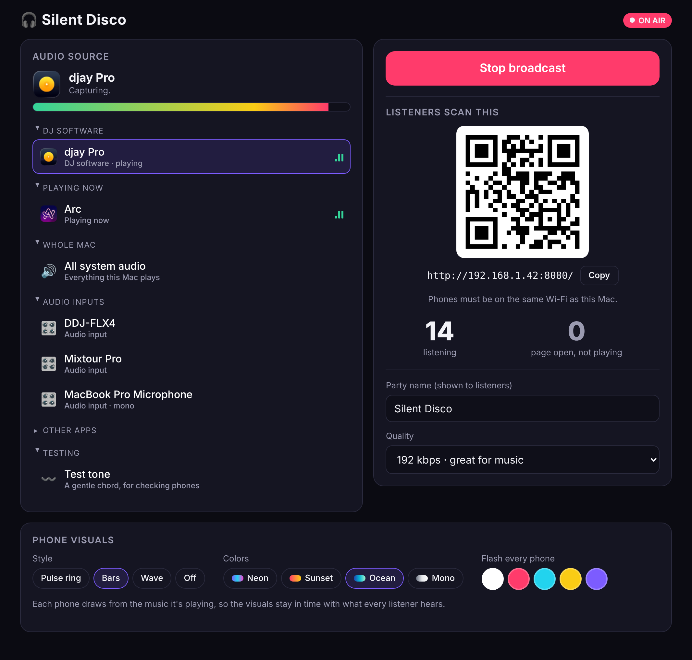
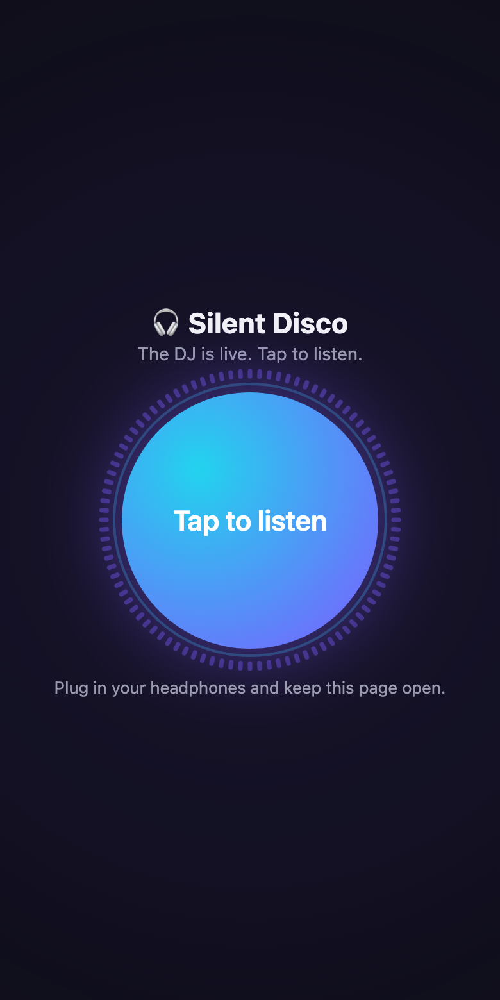
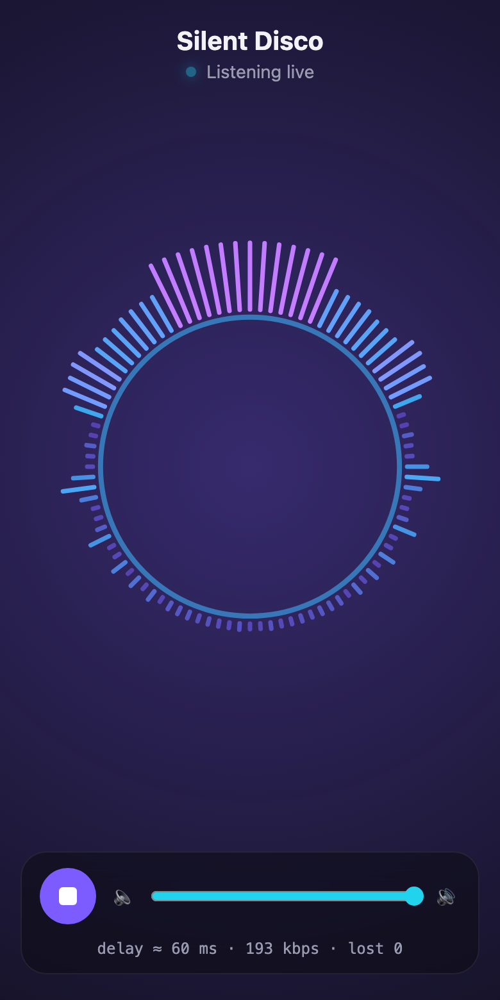

# Silent Disco

 

> **Alpha:** a side project under active development. Expect rough edges, and the Mac app in `native/` isn't packaged for download yet.

Turn your Mac into a silent disco transmitter. You play music on the Mac (DJ software, Spotify, anything), and people on the same Wi-Fi scan a QR code, tap **Listen** in their phone's browser and hear it in their headphones. No app for listeners, no special hardware.

## What it looks like

<table>
  <tr>
    <td width="60%"></td>
    <td width="20%"></td>
    <td width="20%"></td>
  </tr>
  <tr>
    <td align="center"><b>1. The DJ goes live</b><br>Pick the audio source, hit <i>Go live</i>, show the QR code.</td>
    <td align="center"><b>2. Guests scan and tap</b><br>No app or account, just a browser.</td>
    <td align="center"><b>3. Everyone dances silently</b><br>Own headphones, own volume, ~60 ms delay.</td>
  </tr>
</table>

**In short:** the music plays on your Mac, the Mac streams it over Wi-Fi to every phone that scans the QR code, and each guest listens in their own headphones while the room stays quiet.

## How it works

```
DJ software ──► BlackHole (virtual audio cable) ──► Host page in Chrome on your Mac
                                                        │  WebRTC (Opus, stereo, 192 kbps)
                                                        ├──► Phone 1 browser
                                                        ├──► Phone 2 browser
                                                        └──► …
server.js: serves the pages and passes connection setup messages. Audio never goes through it.
```

* **Capture.** macOS does not let apps record another app's output directly, so the standard trick is **BlackHole**, a free virtual audio device. Your DJ software outputs to BlackHole, and the host page records from BlackHole like a microphone.
* **Transport.** The host page opens one WebRTC connection per listener, straight across your Wi-Fi. WebRTC is what video calls use: it is built for low delay, uses the Opus codec (excellent for music at 192 kbps), and hides small Wi-Fi hiccups with error correction.
* **Listeners** just need a browser. No install, no account.

### Latency, honestly

| Approach | Typical delay | Why not |
|---|---|---|
| Twitch / HLS streaming | 3 to 30 s | Way too late to dance to |
| Plain web radio (Icecast/MP3) | 1 to 5 s | Same problem |
| **WebRTC on local Wi-Fi (this)** | **~60 to 200 ms** | Chosen |
| Raw packets + custom native app | ~20 to 50 ms | Needs an app installed on every phone |

In testing the network and buffering part measured about **50 ms**. On a real party Wi-Fi expect 80 to 200 ms, and each listener's phone may drift a little from the next. That's fine for a silent disco because everyone is in their own headphones. Two things add a lot more delay: **Bluetooth headphones add 150 to 300 ms** (wired is best; AirPods are okay), and a crowded, weak Wi-Fi.

## Setup on your Mac (one time)

1. **Install Node.js** (LTS) from https://nodejs.org.
2. **Install BlackHole 2ch** from https://existential.audio/blackhole/ (free), or with Homebrew: `brew install blackhole-2ch`. Restart your Mac afterwards if it doesn't show up.
3. **Use Google Chrome** for the host page. (Safari and Firefox also work, but Chrome gives the best audio quality controls.)

## Running a party

1. Double-click **`Start Silent Disco.command`**, or run `npm start` in this folder from Terminal.
   * The first time, macOS may say it's from an unidentified developer: right-click the file, choose **Open**, then **Open** again.
   * If macOS asks whether **node** may accept incoming network connections, click **Allow**. Phones can't connect otherwise.
2. The host page opens at `http://localhost:8080/host`. Open it in Chrome if it opened somewhere else, and allow microphone access (that's how it reads BlackHole).
3. Pick **BlackHole 2ch** as the input (it's chosen automatically if installed).
4. In your DJ software, set the **master output** to **BlackHole 2ch**. Keep your headphone cue on your controller or audio interface as usual. You should see the level meter move.
   * To *also* hear the master on the Mac's speakers or an interface, open **Audio MIDI Setup**, click **+ → Create Multi-Output Device**, tick BlackHole 2ch and your speakers, and choose that Multi-Output Device as the output.
   * Not using DJ software? Set the Mac's sound output (System Settings → Sound) to BlackHole or that Multi-Output Device, and anything you play is broadcast.
5. Click **Go live**. Put the QR code on a screen or print it.
6. Guests join the same Wi-Fi, scan, tap **Tap to listen**, and plug in headphones.

**No BlackHole?** The **Use tab / system audio instead** button lets Chrome share a browser tab's audio (e.g. a YouTube or SoundCloud tab), and on recent macOS versions the whole system's audio.

## Things to know

* **Same network.** Phones must be on the same Wi-Fi as the Mac. Hotel, venue and many "guest" networks block phones from talking to each other ("client isolation"). If people get stuck on "Connecting to the DJ…", that's the likely cause. A cheap travel router or your own home router is the reliable fix.
* **How many listeners?** Each listener is a separate stream from your Mac (192 kbps each), so 30 listeners ≈ 6 Mbit/s of Wi-Fi. A recent MacBook on decent Wi-Fi should handle a few dozen. Drop Quality to 128 kbps for bigger groups. Going past ~50 needs a relay server (see roadmap).
* **Phones.** Listeners should keep the page open with the screen on (the page asks the phone to stay awake). Locking an iPhone can pause WebRTC audio. The volume slider works on every phone, and on iPhone audio plays even with the silent switch on (iOS 17+).
* **Keep the host tab open.** If you reload it or restart the server, listeners reconnect automatically.
* **Port.** Uses port 8080. To change it: `PORT=9000 npm start`.
* **Security.** Anyone on the same Wi-Fi with the link can listen. The host page only works from the Mac itself.

## How the code is organized

The web pages are written in **TypeScript** with **Solid** for the UI and **XState** state machines for all the connection logic, built with **Vite**. The server is a single dependency-free Node file.

| Path | What it does |
|---|---|
| `server.js` | Serves the built app from `dist/` and relays connection setup messages. No dependencies. |
| `src/listener/machine.ts` | The phone's lifecycle as a state machine: idle, waiting for the DJ, joining, connecting, playing, dropped and reconnecting. |
| `src/listener/peer.ts` | The WebRTC connection to the DJ, as an actor the machine starts and stops. Reports stats. |
| `src/listener/audioOutput.ts` | Playback through Web Audio, so the volume slider works on every phone. |
| `src/listener/App.tsx` | The phone UI. Status text is derived from the machine's current state. |
| `src/host/machine.ts` | The DJ console machine. Two parallel regions (audio source, on/off air) and one spawned actor per listener. |
| `src/host/peer.ts` | One WebRTC connection to one listener. |
| `src/host/capture.ts` | Opening BlackHole or another input, tab/system audio sharing, device and track watchers. |
| `src/host/App.tsx`, `Meter.tsx`, `QrCode.tsx` | The host UI. |
| `src/listener/status.ts` | The status line text, derived from the machine state (kept separate so it's testable). |
| `src/**/machine.test.ts` | Model-based tests (see below). |
| `src/console/` | The DJ console for the Mac app window (`native/`). Talks to the app's API instead of doing WebRTC itself. |
| `src/shared/` | Signaling client, Opus quality tuning, styles. |
| `dist/` | The built app. Included so `npm start` works without building. |

## Changing the code

```
npm install        # once
npm run dev        # hot reload on http://localhost:8080/host.html
npm run build      # rebuild dist/ for `npm start`
npm run typecheck
npm test           # model-based tests of both state machines
npm run test:go    # the Mac app's Go tests, with the race detector
npm run test:e2e   # browser tests against the real app (builds it first)
npm run test:all   # all of the above, plus typecheck
```

The first time on a machine, `npx playwright install chromium` fetches the browser the e2e tests use.

### Model-based tests

`src/listener/machine.test.ts` and `src/host/machine.test.ts` don't list scenarios by hand. `xstate/graph` explores each state machine, finds a path to every distinct state (about 45 for the listener and 315 for the host), and then tries every possible event from each one. Each run drives the real machine with fake signaling, audio devices and WebRTC peers that record what happened, and checks two kinds of rules after every step:

* **Invariants** hold in every state, whatever route led there. For example: each listener hears the current source when on air and silence when off; there's never more than one connection per listener; replaced audio sources are released; joining always means a join was just sent.
* **Transition rules** say what a specific event must do, written separately from the machine. For example: a failed connection always rejoins, a blip while playing waits before rejoining, and picking a device never takes you off air.

When you change a machine, the paths regenerate automatically, so new states get covered without writing new tests.

### Tests for the Mac app (`native/`)

The phone page's machines are statecharts, so XState can walk them. The Go engine isn't a statechart; its model is a fake Mac plus a list of rules, and [rapid](https://github.com/flyingmutant/rapid) generates the walks:

* **Model-based** (`engine_model_test.go`). Thousands of random party timelines: apps open, quit, restart and start playing, inputs get plugged and unplugged, macOS blocks a source, the DJ picks sources and goes live. After every step the engine must obey the rules: exactly one capture while capturing, of the right processes; an error always says why; once the DJ picks a source it never switches away on its own; phones are told the truth about being live and hear silence when off air. Rescans have their own rules (follow an app to its new processes after a restart, wait under the same name when it quits, don't retry a blocked capture until something changes). A failure shrinks to the shortest timeline that breaks a rule.
* **Property** (`property_test.go`). Rules that hold for any input: the resampler gives the right length, never overshoots, keeps a steady level, and sounds the same however Core Audio chunks the buffers; every full 20 ms of audio is exactly one Opus frame; each process lands in one app and the list is in DJ-first order; any settings file, even garbage, loads as something usable; and the hub never forgets a phone whose audio is still playing, however its event streams drop and reconnect.
* **Real audio** (`audio_test.go`). A fake phone built from Pion connects over real WebRTC, decodes the Opus it receives, and checks the test chord arrives with C♯ on the left and E on the right. Then it goes off air (silence, not a gap), drops its event stream (the audio keeps flowing), and resumes as the same phone.
* **Console API** (`api_test.go`). The token and this-Mac-only checks, source picks, going live, name and quality limits, visuals and flashes reaching phones.
* **Browser** (`e2e/`). Chromium phone pages and the DJ console against the real binary with `-nowindow -tone`: a phone hears the DJ, off air and back, the stream to the page server is cut and the music keeps playing on the same connection, the DJ restyles and flashes phones.

`native/build.sh` runs the Go tests before building and stops if they fail (`SKIP_TESTS=1 ./build.sh` to build anyway).

In dev mode, phones can still join from the QR code. Unlike `npm start`, dev mode doesn't lock the host page to this Mac.

## Roadmap ideas

* **Proper Mac app**: in progress in `native/` (Go + Core Audio taps, no BlackHole, native window with the console in `src/console/`). See `native/README.md`.
* **Channels / multiple DJs**: one host page per channel, listeners pick a channel (red/green/blue like real silent disco headsets).
* **Over the internet**: add a STUN/TURN server and HTTPS so remote friends can join, and an SFU (e.g. LiveKit or mediasoup) to scale to hundreds of listeners.
* **Tighter sync between phones** with a shared clock and fixed playout delay.

## License

[MIT](LICENSE)
